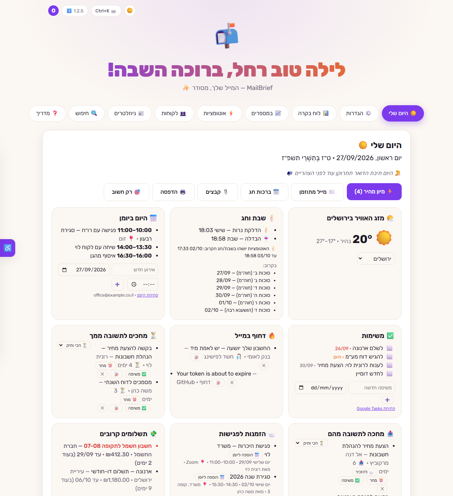
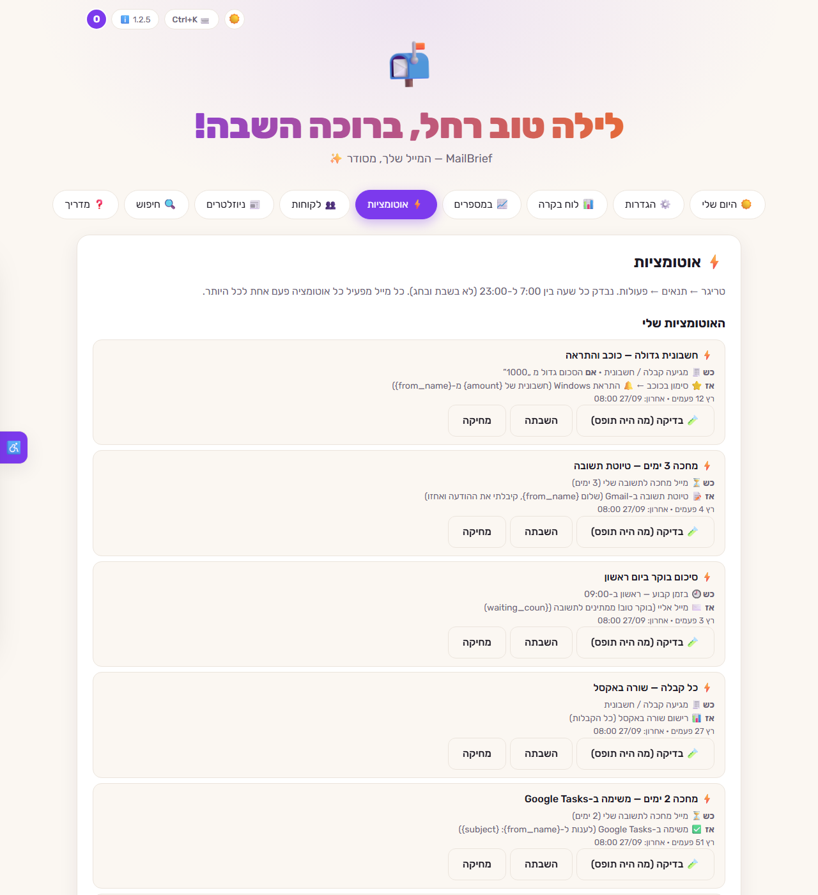
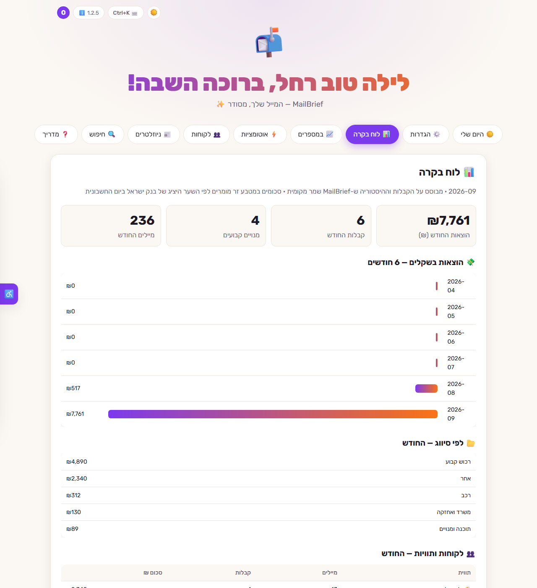

<div align="center">


# MailBrief

**תיבת דואר ועוזר מייל מקומי לכל תיבה — בלי AI, בלי ענן, בלי שהמייל שלך יוצא מהמחשב.**

דואר נכנס מלא · תדריך שבועי · „היום שלי” · אוטומציות · קבלות ואקסל · זיהוי פישינג · לוח שנה עברי · שבת וחג


[⬇️ הורדה — MailBrief-Setup.exe](https://github.com/ayal408/mailbrief/releases/latest) · `winget install mailbrief` · [English](#english)

</div>

---

## מה זה

MailBrief רץ על המחשב שלך ומתחבר לתיבות הדואר שלך (Gmail, Microsoft, או כל שרת IMAP).
אפשר לקרוא, לכתוב ולסדר בו את כל המייל כמו בכל תוכנת דואר — ובנוסף הוא ממיין, מתריע, רושם קבלות ומריץ אוטומציות,
לפי כללים פשוטים שאפשר לראות ולשנות, בלי בינה מלאכותית ובלי שרת חיצוני.
כל הנתונים נשמרים בתיקייה אחת על המחשב, והסיסמאות וההרשאות מוצפנות עם ההצפנה של Windows.

<p align="center">
  
  
</p>

## 📥 תיבת דואר מלאה

הלשונית הראשונה היא דואר נכנס של ממש — בלי לפתוח את Gmail:

- **כל התיבות ברשימה אחת**, או כל תיבה עם התיקיות והתוויות שלה; ספירת הלא-נקראו גם בכותרת החלון
- **חלונית קריאה** — המייל מוצג בארגז חול מבודד, תמונות מהאינטרנט חסומות עד „הצגה”, הטקסט המצוטט מקופל,
  השיחה כולה נפתחת במקום, צפייה בקבצים (תמונות, PDF, טקסט, שמע ווידאו), הדפסה, ותרגום בלחיצה
- **כתיבה** — תשובה, לכולם, העברה עם הקבצים; עורך עשיר (מודגש, צבעים, רשימות, קישורים, ימין/שמאל), גרירת קבצים,
  תבניות תשובה, טיוטה שנשמרת לבד, 10 שניות לביטול שליחה, ושליחה מאוחרת — גם בתאריך ושעה מלוח השנה העברי
- **סידור** — נקרא / כוכב / ארכיון / מחיקה / ספאם / העברה, להודעה אחת או לרבות (Shift לבחירת טווח), גרירה לתיקייה,
  תפריט בלחיצה ימנית, ו**↩️ ביטול** אחרי כל העברה או מחיקה
- **תיקיות ותוויות** — יצירה, שינוי שם, מחיקה, הצמדה, הסתרה, צבע; סימון הכול כנקרא, ריקון אשפה וספאם
- **חיפוש בסגנון Gmail בכל תיבה** — `from:` `subject:` `has:attachment` `is:unread` `newer_than:7d` `after:` `larger:5M`, ופאנל חיפוש מתקדם
- **בזמן אמת ובלי אינטרנט** — מייל חדש מופיע תוך שניות (IMAP IDLE); ההודעות האחרונות נקראות מראש ונפתחות גם בלי חיבור
- **ליד כל מייל** — כרטיס שולח (כמה מיילים, כמה מהר עונים, לקוח, קבלות), אזהרת פישינג, ותפריט ⋯:
  תזכורת (גם בתאריך), נודניק, משימה ב-Google, שמירה כקבלה, ביטול מנוי, חסימת שולח, שמירת כל הקבצים
- **סקירה** — לא-נקראו בכל תיבה, האחרונים שלא נקראו וגרף המייל של השבוע
- **מקלדת** — `J`/`K` מעבר · `R` תשובה · `A` לכולם · `F` העברה · `E` ארכיון · `#` מחיקה · `S` כוכב · `U` לא נקרא · `C` חדשה · `/` חיפוש
- **תצוגה** — רשימה רגילה או צפופה, חלונית קריאה בצד או במסך מלא, ובחירת גופן

## יכולות

| | |
|---|---|
| 📬 **תדריך שבועי** | כל יום ראשון: דחוף, מחכים לתשובה ממך, קבלות, אבטחה, ניוזלטרים — בדוח אחד בעברית |
| ☀️ **היום שלי** | נפתח כשנכנסים למחשב: יומן ומשימות, מזג אוויר, זמני שבת, תשלומים, הזמנות לפגישות, טיימר ריכוז ופתקים |
| 🔎 **30 הימים שלך** | מיד אחרי החיבור: כמה עולים המנויים בחודש, אילו ניוזלטרים לבטל בלחיצה, ומי מחכה לתשובה |
| ✉️ **סיכום יומי במייל** | כל בוקר (לא בשבת ובחג) — מה דחוף, מה ביומן ומי מחכה, נוח לקריאה בטלפון |
| 📅 **Google Calendar ו-Tasks** | אירועים ומשימות ב„היום שלי”, הזמנות לפגישות ליומן בלחיצה, ופעולות באוטומציות |
| 📤 **מחכה לתשובה מהם** | שיחות שפתחת ואף אחד לא ענה — עם תזכורת או משימה בלחיצה |
| ⚡ **אוטומציות** | כש___ ← אם___ ← אז___: תווית, העברה, טיוטת תשובה, תשובה אוטומטית, Webhook, אקסל, תזכורת |
| 🧾 **קבלות ואקסל** | שמירת ה-PDF לפי חודש, אקסל חודשי מוכן לרו״ח, שער יציג של בנק ישראל, זיהוי חיוב כפול |
| 💳 **מנויים ותשלומים** | זיהוי חיובים קבועים, תאריכי „לתשלום עד” והתראה יומיים לפני |
| 👥 **לקוחות** | כרטיס לכל לקוח: מיילים, קבלות, ממתינים, הורדת כל הקבצים |
| 🎣 **זיהוי פישינג** | התחזות לבנקים/דואר ישראל, קישורים מטעים, קבצים מסוכנים — עם הסבר למה |
| 📝 **תבניות וחופשה** | טיוטת תשובה ב-Gmail בלחיצה, ומענה חופשה — פעם אחת לכל אדם |
| 🗄️ **ארכיון מקומי** | קבלות ומיילים אישיים נשמרים כקבצי ‎.eml עם דף חיפוש שעובד בלי אינטרנט |
| 🔍 **חיפוש** | בכל התיבות יחד, והורדת כל הקבצים המצורפים מהתוצאות |
| 📈 **במספרים** | כמה מייל, מאיפה, באילו שעות, ואחוז התשובות שלך |
| 🕯️ **שבת וחג** | שום אוטומציה לא רצה מהדלקת נרות עד הבדלה (לפי העיר), ומה שנדחה — רץ אחרי |
| 📅 **לוח שנה עברי** | בכל שדה תאריך בתוכנה: התאריך העברי בכל יום, שבתות וחגים מסומנים, והתאריך המלא ליד השדה |
| 📝 **הצעות מחיר** | הצעת מחיר כ-PDF עם הלוגו, מע״מ ופרטי העסק — נשלחת מהתיבה שלך ונכנסת למעקב |
| 🤝 **אישור פגישה ליומן** | מישהו ענה „ראשון ב-10 מתאים לי”? כפתור אחד מכניס את הפגישה ל-Google Calendar עם הזמנה אליו |
| ⏱️ **כמה זמן חסכת** | כל שבוע: מה MailBrief עשה בשבילך לבד — מיילים שיצאו, אוטומציות, קבלות — וכמה זמן זה חסך בערך |

<p align="center"></p>

## בטיחות ופרטיות

- **מקומי לגמרי** — השרת מאזין רק למחשב עצמו (`127.0.0.1` ו-`::1`); אין שרת חיצוני ואין איסוף נתונים.
  אם תוכנה אחרת תופסת את אותה כתובת, MailBrief מזהה זאת ולא יציג אותה בחלון שלו.
- **בלי סיסמאות** — התחברות עם Google / Microsoft (OAuth). אפשר לבטל גישה בכל רגע.
- **הצפנה** — הרשאות וסיסמאות מוצפנות עם Windows DPAPI: רק המשתמש שלך במחשב הזה יכול לפענח.
- **לא מוחק בעצמו** — האוטומציות רק מתייגות, מעבירות ומעבירות לארכיון. מחיקה קורית רק כשלוחצים עליה, דרך האשפה,
  ועם ↩️ ביטול; מחיקה לצמיתות (ריקון אשפה) רק אחרי אישור כפול.
- **מייל לא יכול להזיק** — התוכן מנוקה (בלי סקריפטים, טפסים ומסגרות) ומוצג בארגז חול שאין לו גישה לתוכנה;
  תמונות מהאינטרנט — שמגלות לשולח שפתחת — חסומות עד שמבקשים. תרגום שולח את הטקסט ל-Google רק כשלוחצים עליו.
- **שליחה זהירה** — תשובות אוטומטיות לא נשלחות לרשימות תפוצה, לרובוטים או לעצמך, ויש מגבלה יומית.
- **קישורים ממיילים** לא נפתחים אלא אם הם HTTPS לאתר ציבורי.

## התקנה

**הכי פשוט — תוכנת התקנה:** להוריד את `MailBrief-Setup.exe` מ-[Releases](https://github.com/ayal408/mailbrief/releases/latest) ולהריץ.
בלי הרשאות מנהל, קיצור בתפריט התחל (ואם רוצים — בשולחן העבודה), והסרה רגילה מ„הגדרות ← אפליקציות”.
MailBrief נפתח בחלון משלו (מנוע WebView2 של Windows), וסגירת החלון משאירה אותו ליד השעון — „יציאה” מהתפריט של הסמל סוגרת לגמרי.

**או winget** (מובנה ב-Windows 10/11):

```powershell
winget install mailbrief     # התקנה
mailbrief                            # הפעלה (או מתפריט התחל)
winget upgrade mailbrief     # עדכון
```

הנתונים נשמרים ב-`מסמכים\MailBrief` ונשארים גם אחרי עדכון או הסרה.

**או נייד, בלי התקנה:** `MailBrief.exe` מ-[Releases](https://github.com/ayal408/mailbrief/releases/latest), בתיקייה משלו — כאן הנתונים נשמרים ליד הקובץ.

בכל הדרכים מופיע בתוכנה כפתור „✨ עדכון עכשיו” כשיש גרסה חדשה (ב-winget: `winget upgrade mailbrief`).

בפעם הראשונה: שם ולשון פנייה, מה חשוב לך — ואז „חיבור עם Google” (הגדרה חד-פעמית של כ-5 דקות, ההוראות בדף עצמו).
התזמונים (תדריך שבועי, בדיקה כל שעה, „היום שלי” בכניסה) וקיצור בתפריט התחל נרשמים לבד.

> Windows עשוי להציג אזהרת SmartScreen כי הקובץ לא חתום דיגיטלית: „מידע נוסף” ← „הפעל בכל זאת”.
> בהסרה (מ„אפליקציות”) התזמונים נמחקים, ונשאלת שאלה אם למחוק גם את הנתונים. בגרסה הניידת: `MailBrief.exe --uninstall` לפני מחיקה.

## הרצה מקוד המקור

```powershell
python main.py            # דף ההגדרות + הסמל ליד השעון
python main.py --run      # התדריך השבועי
python main.py --check    # הבדיקה השעתית
python -m unittest discover -s tests -v
.\build.ps1               # בניית MailBrief.exe
```

הלוגיקה כולה בספריית התקן של Python; החלון עצמו — `pywebview` (`requirements.txt`). בלעדיו MailBrief נפתח בחלון דפדפן.
לבנייה: `requirements-dev.txt`, ולתוכנת ההתקנה [Inno Setup](https://jrsoftware.org/isinfo.php) (`installer/mailbrief.iss`). שחרור גרסה: [RELEASING.md](RELEASING.md).

## מבנה הקוד

```
main.py                   נקודת הכניסה (הופך ל-MailBrief.exe)
mailbrief/
├── config.py             נתיבים ומגבלות
├── storage.py, net.py    קבצים, הצפנה, רשת
├── mail/                 IMAP, OAuth, SMTP, מיון, פישינג, תוויות
│   ├── mailbox.py        דואר נכנס: תיקיות, רשימה, קריאה, פעולות, מטמון SQLite
│   └── sanitize.py       ניקוי HTML של מיילים להצגה בטוחה
├── money/                ספר קבלות, שערים, מנויים, אקסל
├── features/             תדריך, התראות, אוטומציות, תשובות, ארכיון, שבת...
├── web/                  הדפים והשרת המקומי (inbox.py — דף הדואר הנכנס, hebpicker.py — לוח השנה העברי)
├── tray.py               הסמל ליד השעון
└── cli.py                --run / --check / --today
tests/                    בדיקות אופליין (בלי רשת ובלי תיבת דואר)
```

---

<a id="english"></a>

## English

**MailBrief** is a local, rule-based (no AI) mail client and assistant for Windows. It connects to Gmail, Microsoft or any IMAP mailbox
and runs entirely on your PC: a full inbox (unified or per mailbox, folders and labels, a sandboxed reading pane with remote images
blocked, rich-text compose with drafts, undo-send and scheduled send, Gmail-style search for every server, drag-to-folder, undo,
live updates over IMAP IDLE, offline read-ahead, keyboard shortcuts), a Hebrew date picker, a weekly Hebrew brief, a "My day" start page, a trigger → conditions → actions automation engine,
receipts saved to monthly Excel workbooks (with Bank of Israel exchange rates and double-charge detection), phishing detection,
reply templates, vacation replies, a searchable offline archive, and client cards. Automations pause automatically on Shabbat and
Jewish holidays, based on your city.

- Its own window (WebView2 via pywebview); logic uses the standard library only; OAuth sign-in; secrets encrypted with Windows DPAPI; the local server listens on loopback only (`127.0.0.1` and `::1`).
- Install: `MailBrief-Setup.exe` (per-user, no admin) or `winget install mailbrief` from [Releases](https://github.com/ayal408/mailbrief/releases/latest) · Run from source: `python main.py` · Tests: `python -m unittest discover -s tests`

MIT License · Made by [Ayal](https://github.com/ayal408).
